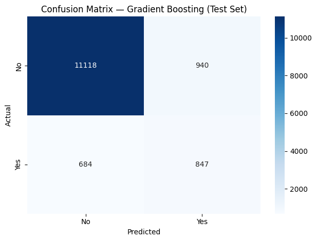
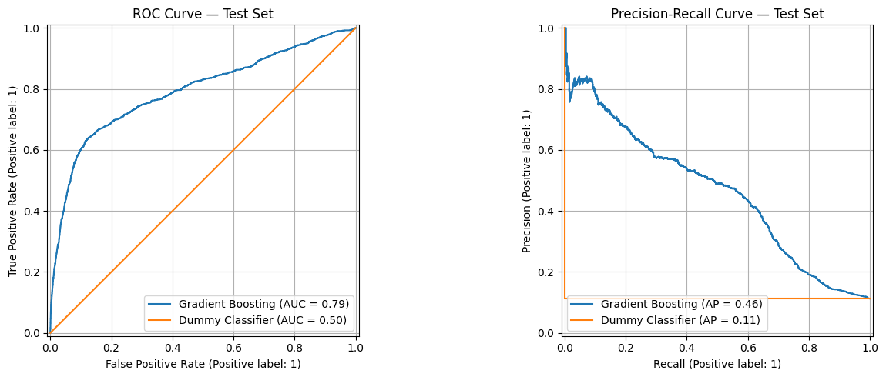
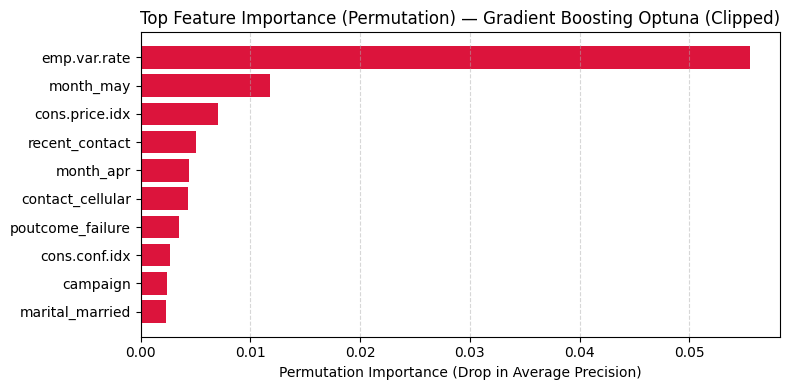

# Bank Marketing: Predicting Term-Deposit Subscriptions

End-to-end machine-learning project on a real telemarketing dataset from a Portuguese bank: exploratory analysis, leakage-aware preprocessing, unsupervised analysis (PCA, K-Means, GMM), ten model configurations compared with cross-validation, and a tuned gradient-boosting model evaluated on a held-out test set.

Final project for the *Machine Learning* course (2025–26), Facultat d'Informàtica de Barcelona (UPC).
Full write-up: [`reports/ML_Final_Project_Report.pdf`](reports/ML_Final_Project_Report.pdf)

## Highlights

- **Task:** predict whether a client subscribes to a term deposit (`y`) from client, campaign and macroeconomic features. 41,188 phone calls, only **11.3 %** positive.
- **Final model:** `HistGradientBoostingClassifier` tuned with Optuna, trained with SMOTE, with the decision threshold chosen on out-of-fold predictions.
- **Test set (13,589 clients):** **ROC-AUC 0.794** and **AUPR 0.462**. A classifier that always predicts "no" gets 0.500 and 0.113.
- **In practice:** at the chosen threshold the model flags 13 % of clients, 47 % of whom subscribe. That is **4.2×** the base rate, and it captures 55 % of all subscribers.
- **No target leakage:** `duration` (length of the call) is only known after the call ends, so it is excluded (the dataset's authors also advise discarding it for a realistic predictive model).
- **Model complexity buys little:** regularised logistic regression is within about 0.005 AUPR of gradient boosting (0.443 vs 0.448 in cross-validation). The problem is close to linear.

## Data

| | |
|---|---|
| Source | [UCI Machine Learning Repository, *Bank Marketing*](https://archive.ics.uci.edu/dataset/222/bank), file `bank-additional-full.csv` (also on Kaggle). Moro, Rita & Cortez (2014), [DOI 10.24432/C5K306](https://doi.org/10.24432/C5K306), licence CC BY 4.0 |
| Period | May 2008 – November 2010, ordered by date |
| Size | 41,188 rows, 20 input features + target |
| Target | `y`: 4,640 yes (11.3 %) / 36,548 no |
| Inputs | client (`age`, `job`, `marital`, `education`, `default`, `housing`, `loan`), last contact (`contact`, `month`, `day_of_week`, `duration`), campaign history (`campaign`, `pdays`, `previous`, `poutcome`), macroeconomics (`emp.var.rate`, `cons.price.idx`, `cons.conf.idx`, `euribor3m`, `nr.employed`) |

Data-quality findings: 12 duplicate rows (removed); no `NaN`, but `"unknown"` acts as missing data (20.9 % of `default`, 4.2 % of `education`, 2.4 % of `housing`/`loan`); extreme values in `campaign` (up to 56 calls); `pdays = 999` is a sentinel for "never contacted". Consistency checks between `previous` and `poutcome` found no contradictions.

## Approach

1. **Clean the full dataset:** drop duplicates, turn `unknown` into `NaN`, drop `duration`, and replace the `pdays = 999` sentinel with a binary `recent_contact` feature (then drop `pdays`).
2. **Two outlier strategies for `campaign`:** *removed* (drop rows with `campaign > 10`, 869 rows) vs *clipped* (cap at 10). Both pipelines are carried through the whole study.
3. **Stratified 67/33 train/test split** (`random_state=42`). The test set is not touched until the final evaluation.
4. **Fit on the training set only:** KNN imputation of `unknown` (k=5), standardisation, one-hot encoding (56 features).
5. **Feature selection:** variance threshold (0.01) and a correlation filter (|r| > 0.90), leaving 47 features (clipped). A PCA version keeps 19 components (about 90 % of the variance). That gives four datasets: removed, clipped, and their PCA versions.
6. **Unsupervised analysis:** PCA, K-Means (elbow and silhouette), Gaussian mixtures (BIC), and how the clusters relate to the target.
7. **Model comparison** with 5-fold cross-validation, SMOTE applied inside each fold. Hyperparameters tuned with 3-fold CV optimising AUPR (grid search; Optuna for the best model).
8. **Final evaluation** of the best model on the test set, with the threshold tuned on out-of-fold predictions and compared against a dummy baseline.

### Key decisions

| Decision | Why |
|---|---|
| Drop `duration` | Only known after the call, so using it would leak the outcome |
| AUPR as the main metric (plus ROC-AUC, macro-F1) | 89 % of rows are "no": a dummy model reaches 0.887 accuracy and is useless |
| Impute after the split | The test set cannot influence imputation or scaling |
| SMOTE inside the CV folds (`imblearn` pipeline) | Oversample only the training part of each fold |
| Compare "remove" vs "clip" for `campaign` | Clipping keeps 869 more rows and scored slightly better, so it was selected |
| Tune the decision threshold (0.297 instead of 0.5) | At 0.5 the model misses too many subscribers; the threshold maximises F1 of the positive class on out-of-fold predictions |

## Unsupervised findings

- PCA: 19 components explain 90 % of the variance (24 for 95 %). PC1 alone explains about 29 %, driven by the highly correlated economic indicators.
- K-Means (k=2, best silhouette): one group with a **24.1 %** subscription rate (n=9,081) and one with **5.0 %** (n=18,506).
- GMM (9 components by BIC, with no sharp minimum, so read it as best trade-off rather than "9 true groups"): one small cluster of 1,135 clients subscribes at **59.8 %**, another at 34.2 %.

<p align="center"></p>

## Results

### Cross-validation (5-fold, clipped dataset, training set)

| Model | AUPR | ROC-AUC | Accuracy | F1 (macro) |
|---|---:|---:|---:|---:|
| **Gradient Boosting (Optuna)** | **0.448** | 0.784 | 0.896 | 0.677 |
| Gradient Boosting (grid search) | 0.446 | 0.784 | 0.897 | 0.669 |
| Lasso logistic regression | 0.443 | 0.786 | 0.815 | 0.661 |
| MLP | 0.441 | 0.785 | 0.818 | 0.665 |
| Logistic regression | 0.441 | 0.784 | 0.816 | 0.662 |
| Ridge logistic regression | 0.441 | 0.784 | 0.816 | 0.662 |
| LDA | 0.436 | 0.784 | 0.808 | 0.655 |
| Random Forest | 0.433 | 0.785 | 0.867 | 0.703 |
| QDA | 0.413 | 0.781 | 0.863 | 0.698 |
| SVM | 0.404 | 0.771 | 0.717 | 0.589 |
| Dummy (most frequent) | 0.113 | 0.500 | 0.887 | 0.470 |

The full table (all four dataset variants) is in Appendix E of the report.

- Linear models, LDA and the MLP are all within 0.01 AUPR of each other. The decision boundary is mostly linear.
- Gradient boosting is best, but its margin over the linear models is small, and Optuna over grid search (0.448 vs 0.446) is within noise.
- The SVM is the weakest and by far the slowest (about 3,000 s vs under 35 s for every other model). It was tuned on a 5,000-row subsample.
- PCA slightly hurt tree ensembles and barely changed linear models.

### Held-out test set (clipped dataset, 13,589 clients)

| Model | Accuracy | Precision (yes) | Recall (yes) | F1 (yes) | ROC-AUC | AUPR |
|---|---:|---:|---:|---:|---:|---:|
| Dummy (most frequent) | 0.887 | 0.000 | 0.000 | 0.000 | 0.500 | 0.113 |
| **Gradient Boosting (Optuna), threshold 0.297** | 0.880 | 0.474 | 0.553 | 0.511 | **0.794** | **0.462** |

Macro-averaged precision / recall / F1 for the final model are 0.710 / 0.740 / 0.720.

<table align="center"><tr>
<td>

| | Predicted no | Predicted yes |
|---|---:|---:|
| **Actual no** | 11,118 | 940 |
| **Actual yes** | 684 | 847 |

</td>
<td></td>
</tr></table>

<p align="center"></p>

### What drives the predictions

Permutation importance puts `emp.var.rate` (employment variation rate) far ahead of every other feature, followed by `month_may`, `cons.price.idx` and `recent_contact`. It ranks first for both non-PCA datasets and both tree ensembles (in the PCA versions, PC1 leads). Macroeconomic context and campaign timing matter much more than client demographics.

<p align="center"></p>

## Repository structure

```
bank-marketing-term-deposit/
├── data/
│   └── bank-additional-full.csv                   # UCI Bank Marketing (CC BY 4.0)
├── notebooks/
│   └── bank_marketing_classification.ipynb        # full pipeline, saved with outputs
├── reports/
│   └── ML_Final_Project_Report.pdf                # technical report (23 pages)
├── images/                                        # figures used in this README
├── requirements.txt
└── README.md
```

## How to run

```bash
git clone https://github.com/lluismomporuiz/bank-marketing-term-deposit.git
cd bank-marketing-term-deposit
python -m venv .venv
source .venv/bin/activate          # Windows: .venv\Scripts\activate
pip install -r requirements.txt
jupyter lab notebooks/bank_marketing_classification.ipynb
```

Run the notebook **top to bottom**: later cells reuse variables created earlier.

- **Full run: more than 4 hours** (grid searches, SVM and Optuna), depending on hardware. The notebook is saved with its outputs, so you can read every result on GitHub without running it.
- **Fast run:** the tuning cells print the selected hyperparameters, so you can hard-code them and skip the search. With the values below, preprocessing plus the final model takes about two minutes.
- **scikit-learn ≥ 1.8 is required.** The logistic-regression variants choose L1/L2 through `l1_ratio`; older versions ignore it and would silently turn the "Lasso" into an L2 model.

<details>
<summary>Selected hyperparameters (clipped dataset)</summary>

| Model | Hyperparameters |
|---|---|
| Ridge logistic regression | `C = 1438.45` |
| Lasso logistic regression | `C = 0.034` (solver `saga`) |
| MLP | 1 hidden layer, 4 neurons, logistic activation, `alpha = 0.1` |
| SVM | linear kernel, `C = 0.001` |
| Random Forest | 200 trees, `max_depth = 10`, `max_features = "sqrt"` |
| Gradient Boosting (grid) | `learning_rate = 0.05`, `max_iter = 200`, `max_depth = None` |
| Gradient Boosting (Optuna) | `learning_rate = 0.0533`, `max_iter = 150`, `max_depth = 9`, `min_samples_leaf = 19`, `l2_regularization = 0.000134` |

</details>

**Reproducibility check.** Re-running preprocessing and the final model with the saved hyperparameters in a clean environment (Python 3.13, scikit-learn 1.9.1) reproduced the same dataset shapes and the same test ROC-AUC (0.794) and AUPR (0.462). The F1-optimal threshold came out as 0.264 instead of 0.297, which shifts precision/recall slightly (0.45 / 0.58 instead of 0.47 / 0.55). Threshold-dependent metrics are therefore sensitive to library versions, while the ranking metrics are stable.

## Limitations and next steps

- **Random split on time-ordered data.** The campaigns span 2008–2010 and the macro variables are strongly tied to calendar time, so a random split lets the model "recognise" the period. A **temporal split** (train on earlier months, test on later ones) would be a stricter test of generalisation.
- **Preprocessing sits outside the CV folds.** Imputation, scaling, feature filtering and PCA are fitted on the whole training set before cross-validation. They do not use labels and the test set is untouched, but CV scores may be slightly optimistic. Moving them into the `imblearn` pipeline would fix this.
- **Small gaps between top models** (AUPR 0.433–0.448), so the final choice is not a decisive win. Repeated CV or confidence intervals would show whether the differences matter.
- **Possible extensions:** XGBoost / LightGBM / CatBoost, cost-sensitive learning instead of SMOTE, probability calibration, SHAP explanations, and a business view with an explicit cost per call.

## Data citation

S. Moro, P. Rita and P. Cortez. *Bank Marketing* [Dataset]. UCI Machine Learning Repository, 2014. https://doi.org/10.24432/C5K306

Introductory paper: S. Moro, P. Cortez and P. Rita. *A data-driven approach to predict the success of bank telemarketing.* Decision Support Systems, 62:22–31, 2014.

## Author

Lluís Mompó Ruiz — [GitHub](https://github.com/lluismomporuiz)
